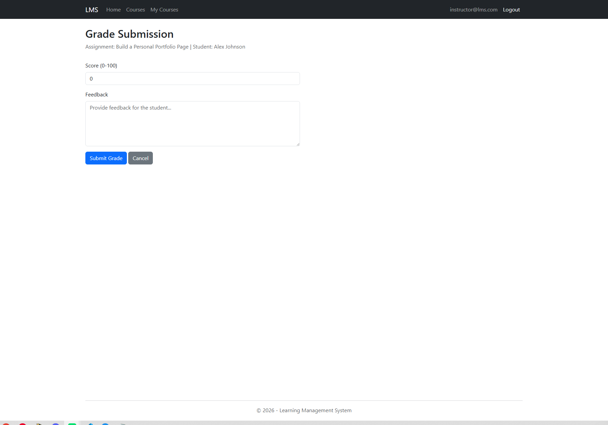
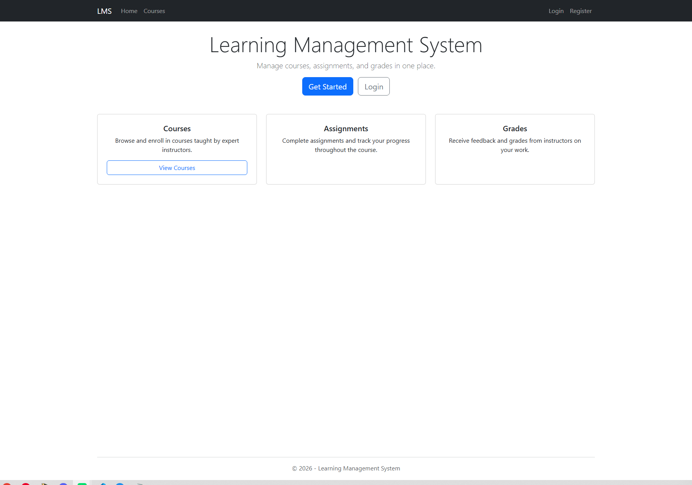
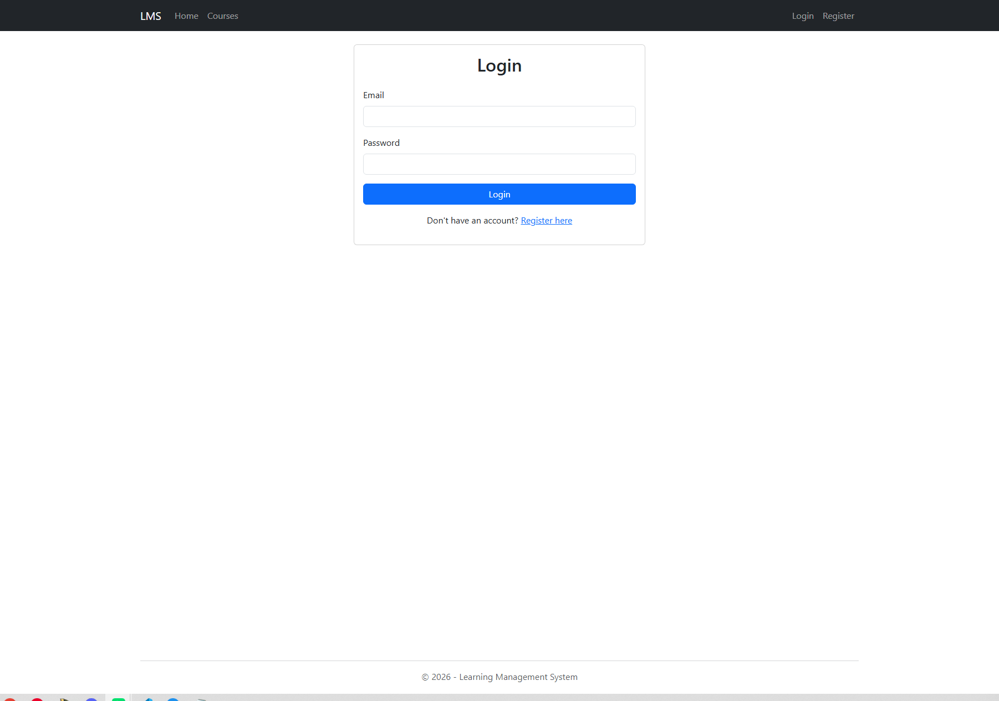
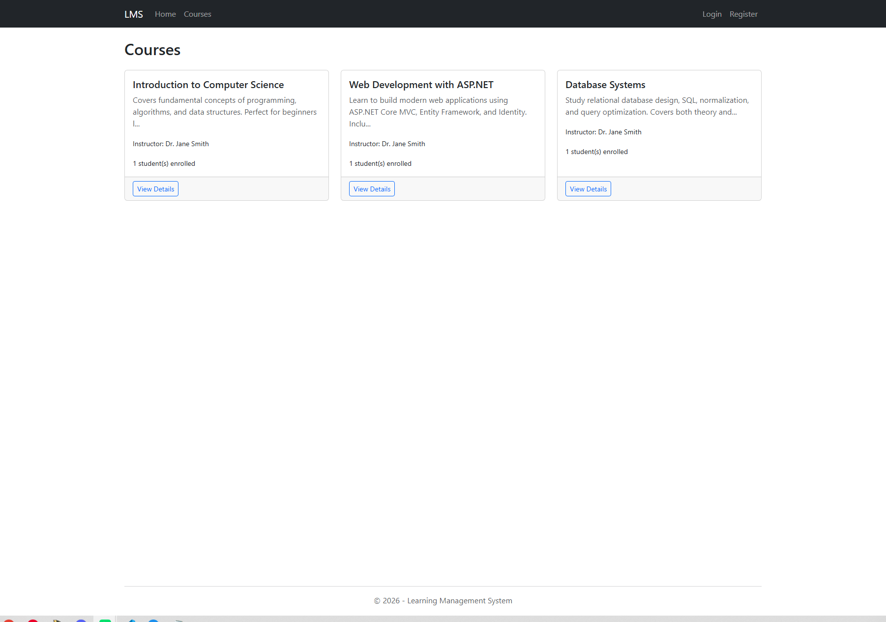
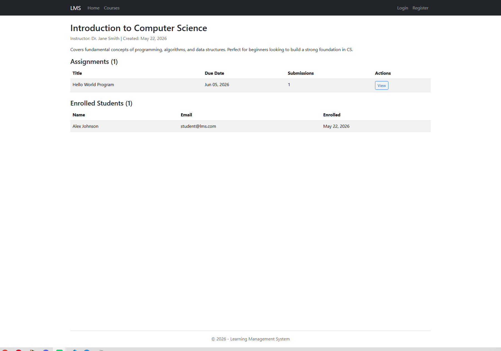
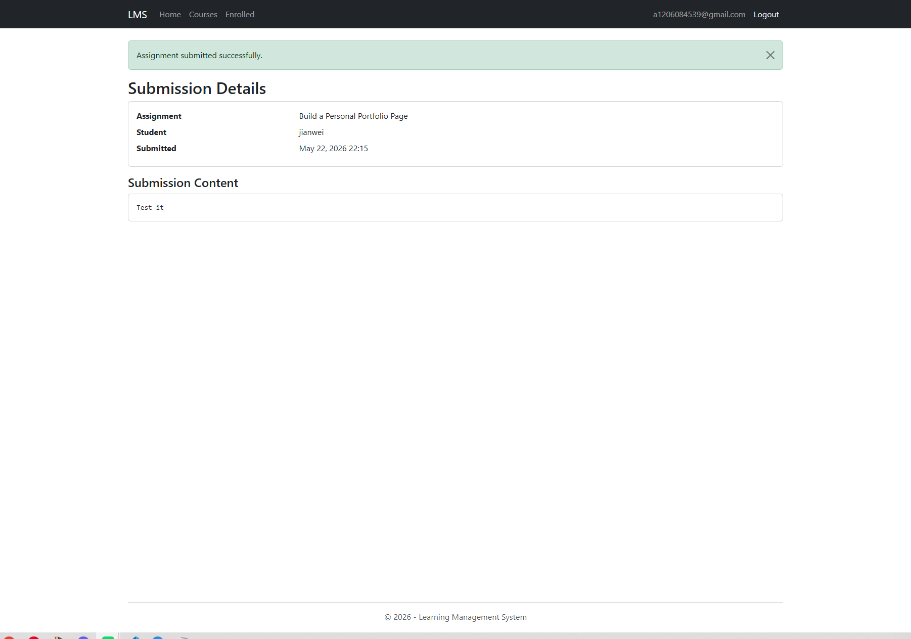
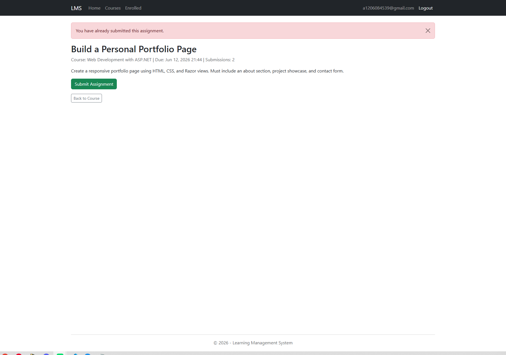
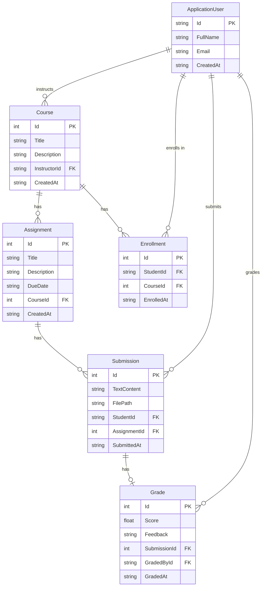

# Learning Management System (LMS)


A full-stack Learning Management System built with **ASP.NET Core 9 MVC**, **Entity Framework Core**, and **MySQL**. Admins, instructors and students each get their own role-based views; student submissions are stored in **AWS S3**.

| Submit an assignment | Grade a submission |
|----------------------|--------------------|
|  |  |

### Highlights

- **Submissions in S3** with file type and size checks (25 MB max); files are served through 15-minute pre-signed links that only the student who submitted, the course's instructor or an admin can request
- **Result pattern** for explicit error handling, so expected failures don't go through exceptions
- **Server-side pagination** using a generic `PagedResult<T>` pushed down to the database
- **76 xUnit tests** against in-memory SQLite covering the service layer, access rules and file validation
- **GitHub Actions** runs the tests on every push and pull request, and pushes a Docker image to Docker Hub only when they pass on `main`

## Tech Stack

| Layer | Technology |
|-------|-----------|
| Backend | ASP.NET Core 9 MVC, C# |
| ORM | Entity Framework Core (Pomelo MySQL provider) |
| Database | MySQL 8.0 |
| File storage | AWS S3 (AWS SDK for .NET, pre-signed URLs) |
| Authentication | ASP.NET Identity, cookie-based sessions |
| Authorization | Role-based (Admin, Instructor, Student) |
| Frontend | Razor Views, Bootstrap 5 |
| Logging | Serilog (structured logging to console + file sinks) |
| Testing | xUnit, SQLite in-memory |
| Containerization | Docker, Docker Compose |
| CI | GitHub Actions |

## Demo

Demo accounts for each role (Admin, Instructor, Student) are seeded automatically on startup. See [`Data/SeedData.cs`](Learning%20Management%20System/Data/SeedData.cs) for credentials.

## Features

### Course Management

- **Role-based access control** — Three distinct roles with dedicated dashboards and permissions
- **Course CRUD** — Instructors create and manage courses; students browse and enroll
- **Duplicate enrollment handling** — Friendly warnings instead of generic error pages

### Submissions & Grading

- **Assignments with deadlines** — Instructors create assignments with due dates; students submit work
- **File uploads to S3** — Students attach a file (PDF, Office docs, source code, zip; up to 25 MB). The file is uploaded before the submission is saved, and removed again if saving fails, so S3 doesn't fill up with orphans
- **Secure downloads** — Files are never public; each download is a 15-minute pre-signed S3 link, issued only to the submitting student, the course's instructor or an admin
- **Assignment resubmission** — Students can revise and resubmit before the deadline; locked after grading or past due
- **Grading with upsert pattern** — Instructors score submissions (0-100) with written feedback; duplicate grade attempts handled gracefully

### Infrastructure

- **Auto-seeded demo data** — Pre-loaded courses, assignments, and users for immediate testing
- **Dockerized deployment** — One-command setup with Docker Compose
- **CI pipeline** — Tests run on every push and pull request; a Docker image is pushed to Docker Hub only when they pass on `main`
- **Rate limiting** — Fixed-window rate limiter (100 requests/min per IP) to prevent abuse
- **MySQL configuration** — Custom `my.cnf` with tuned buffer pool and connection limits
- **Structured logging** — Serilog with console and rolling-file sinks (7-day retention) for production diagnostics

<details>
<summary>More screenshots</summary>

| Page | Preview |
|------|---------|
| Home |  |
| Login |  |
| Course List |  |
| Course Details |  |
| Submit Assignment |  |
| Successful Submission |  |
| Resubmission Warning |  |
| Grading |  |
| My Grades |  |

</details>

## Architecture & Design Decisions

**Result pattern over exceptions** — Service methods return `ServiceResult<T>` instead of throwing exceptions for expected errors (not found, unauthorized, duplicate). This replaces exception-driven control flow with **explicit success/failure paths**, making error handling predictable and testable. A global `ExceptionHandlingMiddleware` still catches truly unexpected failures as a safety net.

**Service layer with dependency inversion** — Controllers depend on **service interfaces** (`ICourseService`, `IAssignmentService`, etc.), not implementations. All business logic lives in the service layer; controllers only handle HTTP concerns and map `ServiceResult` outcomes to views. A shared `BaseController.HandleResult<T>()` method standardizes this mapping across all controllers.

**Server-side pagination** — List endpoints use a generic `PagedResult<T>` record and a `ToPagedResultAsync()` **extension method on `IQueryable<T>`**, pushing `Skip`/`Take` to the database rather than loading full tables into memory.

**Structured logging with Serilog** — Replaced the default logging provider with Serilog for **structured, queryable logs**. Console and rolling-file sinks capture request context for production diagnostics.

**File storage behind an interface** — Controllers and services talk to `IFileStorageService`; `S3FileStorageService` is the real implementation and tests swap in a fake, so submission logic is tested without AWS. Object keys are built from course, assignment and student ids plus a random part, so two uploads never overwrite each other.

**Pomelo MySQL provider** — Chosen over Oracle's MySQL connector because Pomelo is the community-recommended EF Core provider for MySQL, with broader feature support and active maintenance for .NET 9.

## Architecture

```
Learning Management System/
├── Controllers/           # MVC controllers (Course, Assignment, Submission, Grade, Account)
├── Models/                # EF Core entity models
├── Services/              # Business logic layer (interfaces + implementations, S3 storage)
├── DTOs/                  # Data transfer objects with validation
├── Views/                 # Razor views organized by controller
├── Data/                  # DbContext, migrations, seed data
├── Middleware/             # Global exception handling
├── wwwroot/               # Static assets (CSS, JS)
├── Dockerfile             # Multi-stage build (SDK → runtime)
├── Deployment/            # MySQL config (my.cnf)
├── docker-compose.yml     # App + MySQL containers
├── .github/workflows/     # CI pipeline (test, build, push to Docker Hub)
└── LMS.Tests/             # Unit tests (xUnit + in-memory SQLite)
```

### Database Schema



## Getting Started

### With Docker (recommended)

```bash
git clone https://github.com/jianweicheng0822/learning-management-system.git
cd learning-management-system
cp .env.example .env       # edit passwords if you want
docker compose up --build
```

File uploads need an S3 bucket. Add these to `.env` (everything else works without them):

| Variable | What it's for |
|----------|---------------|
| `AWS_S3_BUCKET_NAME` | Bucket that holds submissions |
| `AWS_S3_REGION` | Bucket region, default `us-east-1` |
| `AWS_ACCESS_KEY_ID`, `AWS_SECRET_ACCESS_KEY` | Credentials with read/write access to the bucket |

Visit http://localhost and log in with any demo account above.

### Without Docker

Prerequisites: .NET 9 SDK, MySQL Server

```bash
cd "Learning Management System"
# Set your connection string in appsettings.json or user secrets
dotnet run
```

The app auto-runs migrations and seeds demo data on startup when `SEED_DEMO_DATA=true`.

## Deployment

On every push and pull request, GitHub Actions runs the test suite. On `main`, once the tests pass, it builds a Docker image and pushes it to Docker Hub.

### Required GitHub Secrets

| Secret | Description |
|--------|-------------|
| `DOCKERHUB_USERNAME` | Docker Hub username |
| `DOCKERHUB_TOKEN` | Docker Hub access token |

## Testing

```bash
dotnet test LMS.Tests
```

**76 tests** using **xUnit** with an **in-memory SQLite** database and a fake file store (no MySQL or AWS needed). CI runs them on every push and pull request. Coverage includes:

- `CourseServiceTests` — course CRUD, ownership, and enrollment validation
- `AssignmentServiceTests` — assignment creation, retrieval, and authorization
- `SubmissionServiceTests` — submission creation, resubmission, deadline enforcement, and graded-lock validation
- `GradeServiceTests` — grading, feedback, and duplicate grade prevention
- `FileValidationHelperTests` — allowed/blocked extensions and size limits

## Routes

| Route | Description |
|-------|-------------|
| `/` | Home / Dashboard |
| `/Account/Login` | Login page |
| `/Account/Register` | Registration page |
| `/Account/Profile` | User profile |
| `/Course` | Browse all courses |
| `/Course/Details/{id}` | Course details with assignments |
| `/Course/Create` | Create course (Instructor/Admin) |
| `/Course/MyCourses` | Instructor's courses |
| `/Course/Enrolled` | Student's enrolled courses |
| `/Assignment/Details/{id}` | Assignment details |
| `/Submission/Create?assignmentId={id}` | Submit assignment (Student) |
| `/Submission/MySubmissions` | Student's submissions |
| `/Grade/MyGrades?courseId={id}` | Student's grades for a course |
